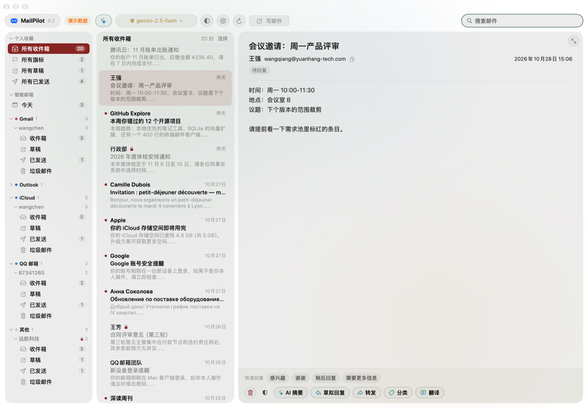
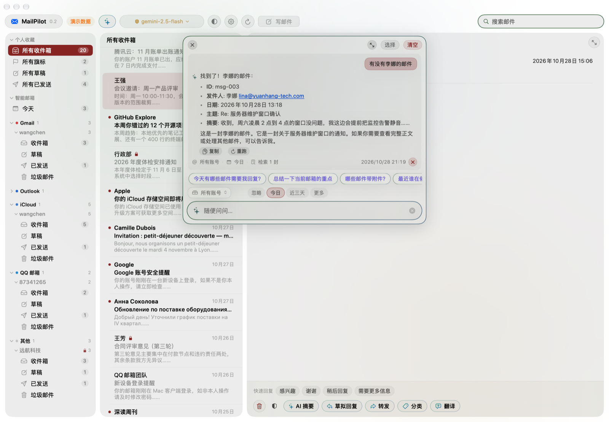

# MailPilot

本地优先的 macOS 邮件客户端：直读「邮件」App 已同步到本机的数据，接入自己的 LLM 做摘要、草拟、分类、翻译和跨账号问答。

**没有后端，没有账号登录，邮件不出本机。**

## 界面



三栏布局：侧边栏按服务商归类账号与邮箱，中间列表按会话聚合，右侧阅读与 AI 动作行。列表里的锁图标表示该邮件已上锁——不可信模型看不到它。



AskBar 跨账号问答：答案下方标注本次范围（所有账号 · 今日）、实际检索到的封数，并列出读过的邮件（可点回原文）。

> 截图取自演示数据模式（未授予完全磁盘访问权限时自动进入）。

## 环境要求

- macOS 26+
- Command Line Tools（`xcode-select --install`）
- 无需安装 Xcode

## 快速开始

```bash
make run      # 编译 + 打包 + 启动
```

或者分步：

```bash
make build    # 产出 build/MailPilot.app
open build/MailPilot.app
```

首次启动会弹出「完全磁盘访问权限」引导，按提示去
`系统设置 → 隐私与安全性 → 完全磁盘访问权限` 勾选 MailPilot 即可读取真实邮件。
未授权前会以演示数据运行，功能可正常体验。

## 常用命令

| 命令 | 作用 |
|---|---|
| `make run` | 构建并启动 |
| `make build` | 只构建打包 |
| `make verify` | 只编译，快速检查编译错误 |
| `make test` | 断言测试（合成邮件 + 本地 mock 模型服务器，不需要磁盘权限） |
| `make clean` | 删除 `.build/` 与 `build/` |

## 目录结构

```
MailPilotNative/
├── Makefile               # run / build / verify / test / clean
├── Package.swift          # SwiftPM 配置（executableTarget）
├── Resources/
│   └── Info.plist         # Bundle 信息（含本地化声明）
├── Sources/MailPilot/
│   ├── App.swift          # @main + 菜单命令
│   ├── AppModel.swift     # @MainActor 状态中心、AI 调用编排、工具调用
│   ├── Models.swift       # Message / Mailbox / Account / MailStore / DemoStore
│   ├── MailAccess.swift   # 完全磁盘访问权限检测与跳转
│   ├── NativeMailStore.swift  # 直读 ~/Library/Mail 的 .emlx
│   ├── EmlxParser.swift   # 轻量 MIME 解析（RFC2047 / base64 / QP / multipart / 附件）
│   ├── MailIndex.swift    # 本地索引（SQLite + FTS5），列表与搜索的数据源
│   ├── AISettings.swift   # 服务商与多密钥管理、流式 / 工具调用（OpenAI / Anthropic / Ollama）
│   ├── AIPreferences.swift # 个性化 / 语气 / 样本 / 翻译偏好
│   ├── MailTool.swift     # 模型可调用的工具定义与权限分级（9 个）
│   ├── AskScopeStore.swift # 问答范围装饰器（账号 + 时间窗口）
│   ├── TrustPolicy.swift  # 动作 × 信任 × 上锁 → 唯一决策来源
│   ├── Redactor.swift     # 脱敏与会话级占位符映射
│   ├── MailGuard.swift    # 邮件 / 账号上锁 + 20 天 TTL 清理
│   ├── MailExemption.swift # 单封「不敏感」豁免
│   ├── GuardedMailStore.swift # AI 通路的访问控制装饰器
│   ├── AuditLog.swift     # 外发与写操作审计（JSONL）
│   ├── MailMutator.swift  # 通过「邮件」App 删除 / 标已读 / 旗标
│   ├── MailSender.swift   # 通过「邮件」App 发信
│   ├── MailBodyRenderer.swift # 邮件 HTML 渲染（WKWebView + CSP 断网）
│   ├── HTMLSanitizer.swift # HTML 白名单清洗
│   ├── RemoteImageLoader.swift # 远程图片代理下载（转 data URI）
│   ├── LinkPolicy.swift   # AI 输出链接风险判定
│   ├── UISettings.swift   # 外观 / 主题 / 布局设置
│   ├── BackgroundImage.swift # 窗口背景图缓存
│   └── Views/             # SwiftUI 界面
├── Tests/                 # 断言测试（合成 .emlx / mock 模型服务器，不依赖 XCTest）
├── docs/
│   └── SPEC.md            # 需求与实现现状
├── scripts/               # build / run / clean / test
└── build/                 # 打包产物（已 gitignore）
```

## 架构

```
┌──────────────┐      ┌───────────────┐      ┌──────────────┐
│   Views      │ ───▶ │   AppModel    │ ───▶ │  MailStore   │
│ (SwiftUI)    │      │  @MainActor   │      │  protocol    │
└──────────────┘      └───────────────┘      └──────┬───────┘
                                                    │
                          ┌─────────────────────────┴──────────────┐
                          ▼                                        ▼
                   DemoStore（演示数据）              NativeMailStore（真实 .emlx）
```

- `MailStore` 是数据源协议，`AppModel` 只依赖协议，因此演示/真实可随时切换
- `NativeMailStore` 不做全量索引：列表与搜索走本地 `index.sqlite`（只 stat 变化过的文件才重新解析），正文按需解析
- AI 层与服务商配置解耦，支持多密钥轮换（401/403/429 自动换下一条）；OpenAI 兼容协议与 Anthropic 都支持工具调用
- 安全层：上锁（`MailGuard`）→ 脱敏（`Redactor`）→ 确认（`TrustPolicy`）→ 审计（`AuditLog`），决策只在一个地方

## 已知限制

- 未读状态不可用（`.emlx` 不存旗标与已读标记，需要读「邮件」App 的私有 Envelope Index）
- 「所有旗标」恒为空
- 没有规则引擎与归档：写操作只有删除（移入废纸篓）、标已读、旗标；不能把邮件移动到其他邮箱
- 搜索走本地 FTS5 索引（trigram），覆盖全部邮件；索引首次建立后才会生效，之前的查询退回现场解析
- 删除、标已读、旗标都走「邮件」App，本地不直接改文件
- **每次重新编译都会改变 ad-hoc 签名，「完全磁盘访问权限」需要重新授权**
  （长期方案是固定签名证书）

## 推送与协作

```bash
git remote add origin <你的仓库地址>
git push -u origin main
```

提交前建议：

```bash
make verify    # 确认编译通过
make test      # 确认核心逻辑没被改坏
```

版本号写在 `Resources/Info.plist` 的 `CFBundleShortVersionString`，与 CHANGELOG 的最新条目保持一致。改动功能后两处一起更新。

## License

尚未选定。如需开源，在 `LICENSE` 中补充协议文本。
